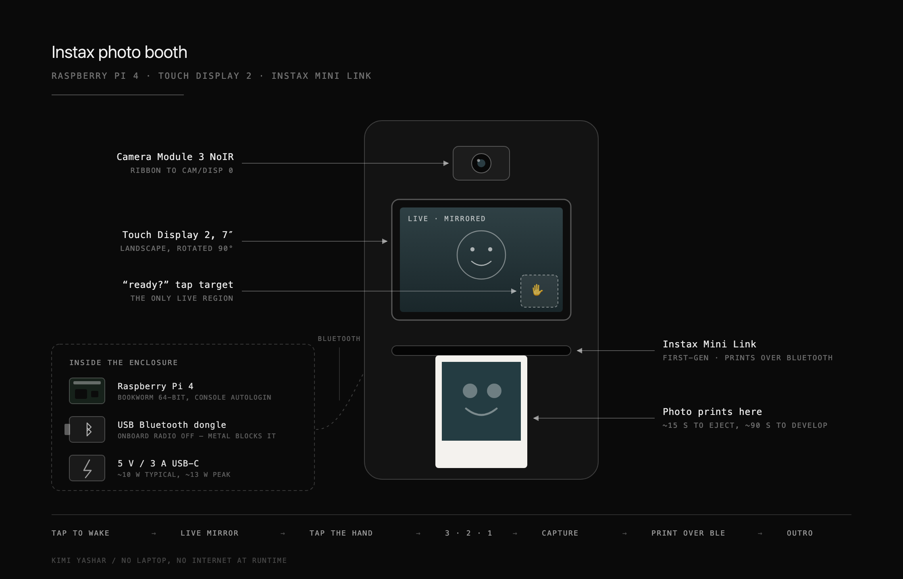
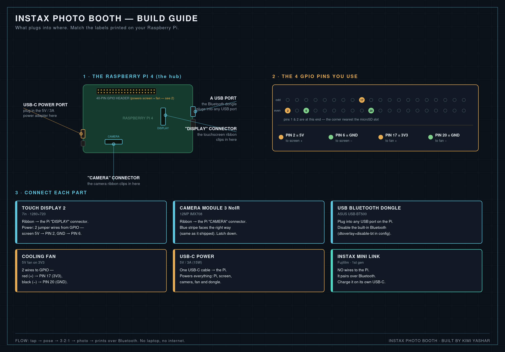

# Instax Photo Booth

A self-contained, portable photo booth built on a Raspberry Pi 4 with a
touchscreen and camera. Tap the screen, strike a pose, and it runs a 3-2-1
countdown, takes a photo, and prints it on a Fujifilm **Instax Mini Link** over
Bluetooth. No laptop and no internet needed at runtime.

## Schematic



## Wiring



A full parts list and step-by-step build walkthrough lives in
[`docs/build-guide.md`](docs/build-guide.md).

## How it works

1. **Welcome screen** — tap anywhere to begin.
2. **Live mirror preview** — a mirrored live camera feed inside a vintage lace
   frame, with a "ready?" hand in the corner.
3. **Tap the "ready?" hand** to start the countdown (tapping the preview does
   nothing, so people get time to pose).
4. **3-2-1 countdown**, a white flash, and the photo is captured.
5. **Print** — the photo is cropped to the Instax 3:4 format and sent to the
   Mini Link over Bluetooth.
6. **Outro screen**, then back to the welcome screen for the next person.

## Hardware

- Raspberry Pi 4 (4GB), Raspberry Pi OS **Bookworm** 64-bit, console autologin
- Raspberry Pi **Touch Display 2** (7 inch), mounted in landscape (rotated 90 deg)
- Raspberry Pi **Camera Module 3 NoIR**
- **USB Bluetooth dongle** (e.g. ASUS USB-BT500) — the onboard Bluetooth is
  disabled because a metal enclosure blocks it; the external dongle on a short
  extension is far more reliable
- Fujifilm **Instax Mini Link** (first-gen) printer
- 5V / 3A (15W) USB-C power supply. Total draw is ~10W typical, ~12-13W peak.
  The printer runs off its own internal battery and is not on this budget.

## Software setup (on the Pi)

```bash
# system packages
sudo apt update
sudo apt install -y python3-picamera2 python3-pygame python3-pil python3-numpy

# python deps for the printer library
pip install bleak simplepyble --break-system-packages

# put this repo at /home/pi/instax-photobooth
# then run it:
cd /home/pi/instax-photobooth
python3 booth.py
```

### Disable onboard Bluetooth (use the USB dongle)

Add to `/boot/firmware/config.txt`:

```
dtoverlay=disable-bt
```

Reboot, then confirm the dongle is the active adapter with `hciconfig`.

### Auto-start on boot (plug in and go)

With console autologin enabled, add this one line to `/home/pi/.bashrc`:

```bash
bash /home/pi/instax-photobooth/start-booth.sh
```

`start-booth.sh` only launches on tty1, gives a 3-second Ctrl+C escape to a
normal prompt, powers on Bluetooth, and then starts the booth.

## The printing gotcha (important)

Getting a first-gen Mini Link to actually eject film was the hard part of this
build. Stock InstaxBLE would connect, accept the image, and then stall — or
flash a yellow film-eject error and never print.

`InstaxBLE/` here is a patched copy of
[javl/InstaxBLE](https://github.com/javl/InstaxBLE) (MIT, Jasper van Loenen —
see `InstaxBLE/LICENSE.md`) with three changes, all in `InstaxBLE.py`:

- **Anti-hang timeout on the notification wait.** The stock loop waits on
  `waitingForResponse` forever; a printer that drops a notification hangs the
  booth. It now gives up after 6 seconds and moves on.
- **Flow-control writes with retry/fallback.** Packets go out with
  `write_request` and retry up to 4 times, falling back to `write_command`
  instead of raising on the first failure.
- **A "blind send" print loop.** During the image transfer, `blindSend` skips
  notification pacing entirely, which is what finally made prints land.

If you still get a yellow flashing error and no print, the image is too large
for your printer. Both `pil_image_to_bytes(...)` calls in `sendImage` pass
`max_size_kb=105`; lower that value (48 is a known-good fallback) and retry.

## Configuration

Everything tweakable lives at the top of `booth.py`:

| Setting | What it does |
|---|---|
| `DEVICE_NAME` | your printer's Bluetooth name (e.g. `INSTAX-12345678`) |
| `PRINT_ENABLED` | set `False` to test the flow without printing |
| `SCREEN_ROTATE` | display rotation in degrees (90 for landscape here) |
| `MIRROR_PREVIEW` | mirror the live preview left-right, like a real mirror |
| `FLIP_PREVIEW_V` | flip the preview vertically if it comes out upside-down |
| `MIRROR_PRINT` | also mirror the printed photo to match the screen |
| `READY_ZONE` | the tap target box for the "ready?" hand, in 1280x720 canvas coords |
| `PRINT_WAIT` | seconds to hold the Bluetooth connection open while the film ejects |

## Assets

`assets/` holds the UI art at 1280x720:

- `idle.png` — welcome screen
- `frame_bg.png` — background frame with the camera window
- `frame_florals.png` — lace overlay drawn on top of the live photo
- `hand.png` — the "ready?" hand, shown only during the preview
- `cd1.png` / `cd2.png` / `cd3.png` — countdown numbers
- `outro.png` — closing screen

## Troubleshooting

- **Live feed frozen / a line through the preview** — almost always the camera
  ribbon cable came loose (common after travel). Power off, reseat the ribbon at
  both the camera and the Pi ends, and check it for creases. Confirm the Pi sees
  the camera with `rpicam-hello --list-cameras`.
- **Undervoltage / random freezes** — use a real 5V/3A supply. Check with
  `vcgencmd get_throttled` (should print `0x0`).
- **Yellow flashing on the printer, never prints** — the image is too big; see
  "The printing gotcha" above.

## License

MIT — see `LICENSE`.
